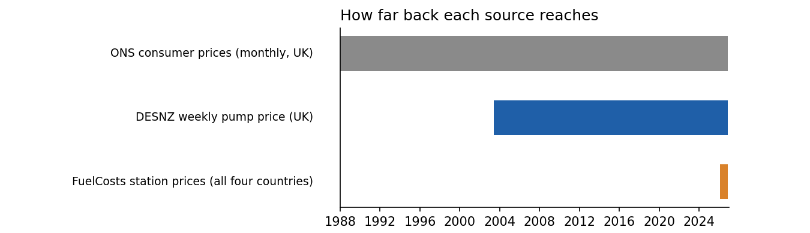
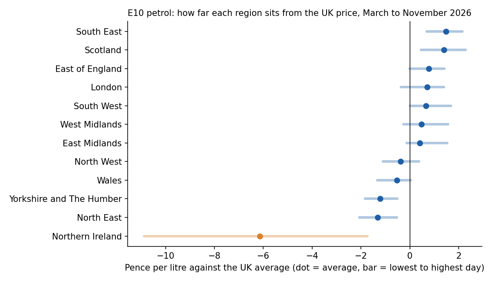
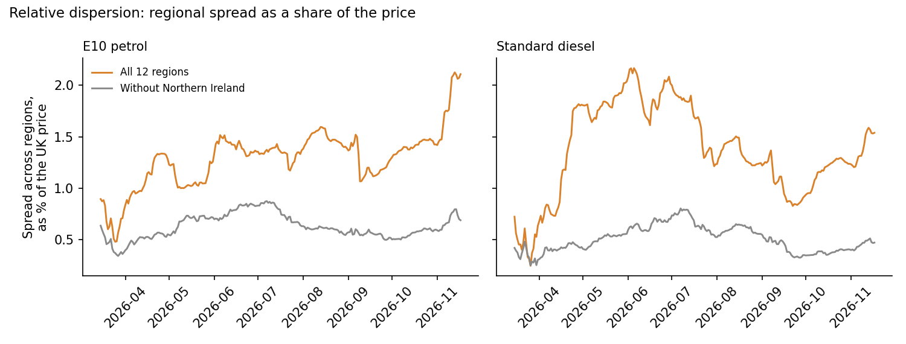
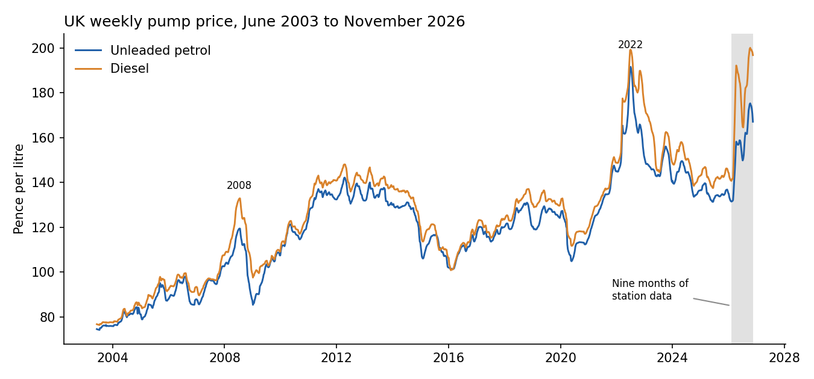
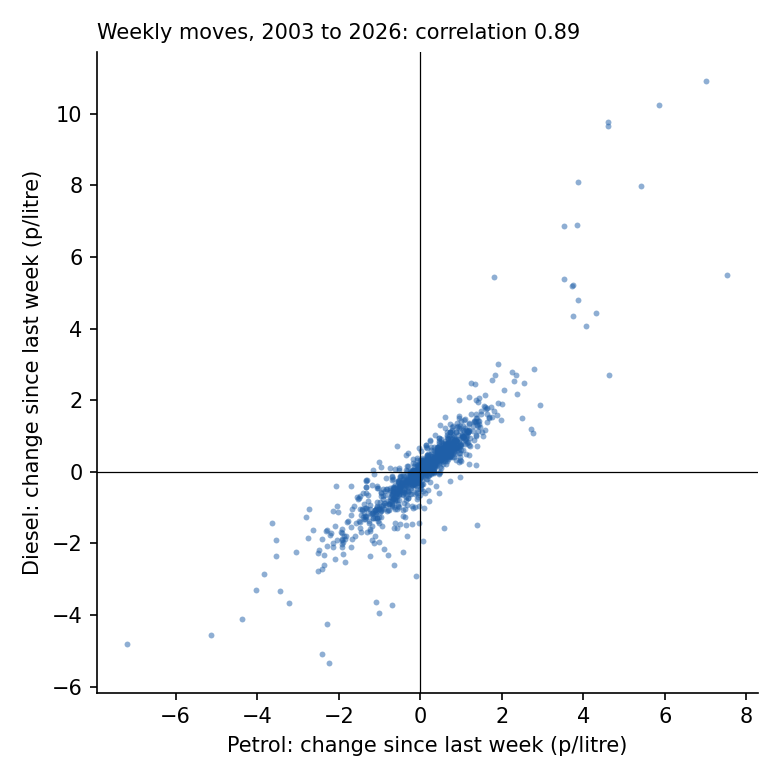
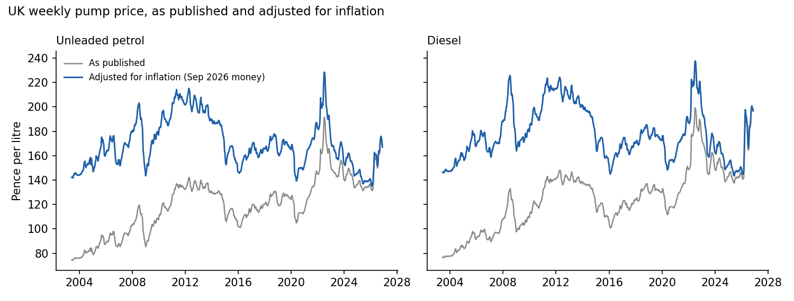

# Research: Why stage 1 falls back to the DESNZ weekly series

> **Status:** Complete for stage 1. Elasticity figures are unverified (see "Not checked").
> **Date:** 2026-11-17. The station data grows each day, so the regional numbers will age fast.

## Question

We want to know whether UK fuel prices help forecast AA breakdown demand. Our
first idea was to use prices by country and region, as well as the UK price. Do
we have enough data to do that, and if not, what do we use instead?

## Summary

Prices differ little between regions of Great Britain: almost always within 2
pence per litre of the UK average. Northern Ireland is the one clear exception,
about 6 pence cheaper for petrol. People respond to price changes, not levels, and a
Great Britain region's price changes almost in step with the UK price (correlation
0.99 or higher), so little is left that is specific to the region. We also have only nine months of station prices, and no country-level
history before February 2026. So we fall back to the DESNZ weekly UK series for
petrol and diesel, which runs from June 2003 and covers more price shocks. We
keep the regional work, and the daily collector, for when the history is longer.

## Definitions

- **Pence per litre (p):** the pump price.
- **DESNZ:** the Department for Energy Security and Net Zero. It publishes the
  weekly UK average pump price, collected on Mondays.
- **Station data:** prices set by individual forecourts, from the official Fuel
  Finder feed (via the FuelCosts copy). Starts February 2026.
- **Gap:** a region's average price minus the UK average, in pence.
- **Spread:** how far apart the 12 regions are. We measure it as the standard
  deviation (a typical distance from the middle) of the region averages.
- **Elasticity:** the percentage change in traffic for a 1% change in price.
  -0.1 means a 10% price rise cuts traffic by 1%.
- **Correlation:** a number from -1 to 1 saying how closely two series move
  together. 1 means in step, 0 means unrelated.

## The story in six steps

### 1. What data exists

Only one fuel-price source goes back more than a year: the DESNZ weekly UK
average, from 9 June 2003 (1,224 weeks). The station data that gives us regions
and countries starts on 7 February 2026 (`docs/sources.md`).

### 2. Regional prices barely differ, except Northern Ireland

From 15 March to 17 November 2026, E10 petrol (the standard unleaded grade):

- Every region in Great Britain averaged within 1.5 p of the UK price. On 98% of
  region-days the gap was under 2 p.
- The gap across Great Britain, top to bottom, was 3.1 p on a 161 p price: 1.9%.
- Northern Ireland averaged 6.1 p below (3.8%), and its gap grew from -3.3 p in
  March to -10.8 p in November.
- Standard diesel looks the same: Great Britain range 2.8 p, Northern Ireland
  7.8 p below.

### 3. The gaps do not widen when prices move

In the weeks with the biggest UK price moves, the spread across regions was
2.0 p; in calm weeks it was 2.1 p. Every region's gap, bar Northern Ireland,
changed by less than 0.05 p for each 1 p the UK price moved. So the national
price tells you nearly all there is to know about the regional price, apart from
a steady offset. Northern Ireland is the one place the offset itself drifts.

### 3b. Relative dispersion: the gaps as a share of the price

Pence are not the whole story, because a 1 p gap matters less on a dear litre.
Dividing by the UK price (15 March to 17 November 2026):

| | E10 petrol | Standard diesel |
|---|---|---|
| Spread across 12 regions (standard deviation) | 2.1 p, 1.3% | 2.5 p, 1.4% |
| Spread without Northern Ireland | 1.0 p, 0.6% | 0.9 p, 0.5% |
| Top to bottom, all 12 regions | 7.8 p, 4.8% | 9.6 p, 5.2% |
| England against the UK | +0.2% | +0.3% |
| Scotland | +0.9% | +0.7% |
| Wales | -0.3% | -0.4% |
| Northern Ireland | -3.8% | -4.2% |

Without Northern Ireland, regions sit within about 0.6% of each other. Is that a
fixed number of pence, or a fixed share of the price? It looks like pence. When
the E10 price was in its cheapest third (about 153 p), the spread was 1.02 p
(0.67%). In its dearest third (about 171 p) it was 0.99 p (0.58%). The price
rose 12%, the spread in pence stayed put, and the share fell. Diesel shows the
same: 1.03 p to 0.79 p. So relative dispersion does not grow when prices rise.
The "all 12 regions" line in the chart climbs only because Northern Ireland's
gap is growing.

### 4. People respond to price changes, not price levels

Elasticity is about changes: a 10% rise cuts traffic by about 1%. A region that
has been 1.5 p dearer for months has already adjusted. What reaches a driver is
the change in their own price, which is the national move plus any change in
their region's gap.

For Great Britain, the national move is almost all of it. Each region's weekly
price change correlates 0.99 or higher with the UK change, and the part that is
specific to the region has a typical size (standard deviation) of 0.20 p a week
for E10 and 0.26 p for diesel. The UK price itself moves 2.4 p a week (E10) and
3.7 p (diesel). With the reported elasticities (`docs/research/traffic-elasticity.md`),
a typical regional-only move shifts traffic by about 0.01% to 0.04% a week.

Northern Ireland is the only case that moves on its own. Its gap changes by 0.83 p
a week for E10 (1.24 p for diesel), about 0.04% to 0.15% of traffic a week. Over
eight weeks its gap moved by up to 4.9 p for E10 and 8.4 p for diesel, which
implies about 0.2% to 1.3% of traffic over two months.

An earlier version of this note multiplied the size of each gap by the elasticity.
That was the wrong quantity, because people react to changes, not to a standing
difference. It overstated the case for regional features.

### 5. We cannot build a long history by country

The long series is UK only. The DESNZ file has no regional or country sheet.
We found no four-country series going back before 2026, and no study of
elasticity by country. Adding a fixed offset to the UK series does not rebuild
it, because Northern Ireland's offset drifted by 7.5 p in nine months. A
regional feature could join to call-out data only over the months we have
collected, which is far too few to test it properly.

### 6. The two fuels move together, but not as one

Over all 1,223 weeks in the DESNZ series:

- Weekly petrol and diesel changes have a correlation of 0.89, and 0.92, 0.88
  and 0.90 in the periods 2003 to 2012, 2013 to 2019 and 2020 to 2026.
- About 21% of diesel's weekly variation has nothing to do with petrol.
- Diesel was 29.7 p above petrol on 16 November, up from 9.3 p on 9 February.
  The all-time range is -2.5 p (August 2015) to +34.0 p (April 2026).

The station data agrees (E10 against standard diesel: 0.92; unique diesel share
16%). We keep two fuel series, not one. If one feature is wanted, an average
of the two, built as an index (each series set to 100 at the start), keeps
97% to 99% of the weekly movement.

## What the fall-back gives us

- **1,224 weeks** (June 2003 to November 2026) against about 40 weeks of station data.
- **More shocks.** Weeks with a price move over 3 p: 36 in all: 4 in 2008, 13 in
  2022 and 14 in 2026. The nine months of station data hold one rise
  and one fall; the long series holds three episodes.
- **Record prices, in pence as published (not adjusted for inflation).** Petrol
  ran from 74.2 p (July 2003) to 191.6 p (July 2022). Diesel reached a record
  200.0 p on 12 October 2026. After adjusting for inflation the 2022 peak was
  higher still (see "Inflation" below).
- **A source that agrees with the station data.** On 41 Mondays, the station
  average sat 0.7 p above DESNZ, with a correlation of 0.99 for levels and
  0.92 to 0.93 for weekly changes. Differences are plausible: DESNZ takes six companies (about 60% of sales) and weights by sales, collected on Monday
  morning, while our figure is the end-of-Monday mean of all stations.

What we give up: any country or region detail, and the Northern Ireland effect.

## Inflation

The prices in steps 1 to 6 are in pence as published (nominal). The adjusted
series is built in `src/features/real_prices.py` and saved to
`data/clean/desnz_real.parquet`.

**Method.** Real price = pence x 100 / CPI (2015 = 100), so the unit is "pence of
2015". Each weekly price uses the latest CPI that ONS had released when that
price became public (`published_at`), so a forecast never sees a future CPI.
For months before November 2015 the release date is unknown; we assume the 15th
of the following month (1,306 of 2,448 rows). The CPI used was a median of 15
days old when the price came out, and at most 43.

**What it shows**, in the money of September 2026 (multiply 2015 pence by 1.441):

| Peak | Petrol as published | Petrol adjusted | Diesel as published | Diesel adjusted |
|---|---|---|---|---|
| 2008 | 119.4 p | 203 p | 132.9 p | 226 p |
| 2022 | 191.6 p | 229 p | 199.2 p | 238 p |
| 2026 (to 16 Nov) | 175.3 p | 176 p | 200.0 p | 201 p |

- **June 2003** petrol (74.6 p as published) is 142 p in today's money. Adjusted,
  petrol is up 17% since 2003 (to 167.1 p); as published it is up 124%.
- **"Record" diesel in October 2026 holds only as published.** After adjusting,
  the 2022 peak (238 p) is 18% higher, and the 2008 peak (226 p) is above 2026.
- **Weekly moves barely change.** The weekly change in the adjusted price
  correlates 0.95 with the weekly change as published, because CPI moves slowly.
  The adjusted series has a small jump in each week a new CPI arrives.
- **As-of against hindsight.** Using the CPI of each price's own month (known
  only later) instead of the as-of CPI changes the adjusted price by 0.5% on
  average and 3.6% at most. The gap is the two-month delay in publication, not
  revisions.
- **For the regional work it still does not matter.** CPI rose 2.9% from
  February to September 2026.
- **Not yet tested:** whether the adjusted price predicts demand better than the
  raw price. That needs the AA call-out data, so it moves to stage 2. Fuel is part
  of CPI, which slightly links the two series.

## Contradictions

- **DESNZ against station data in March 2026.** The gap reached 4.3 p for
  petrol and 6.7 p for diesel on 23 March, during the sharp rise. The
  collection-time difference above fits, but we did not test it.
- **Elasticity sources.** Reported UK values run from -0.07 to -0.29 and an Irish study reports -0.33 to -0.53 for the Republic. We cannot say which suits Northern Ireland.

## Not established

- No published four-country (or regional) fuel elasticity for the UK. We
  searched the web twice and found none.
- No country-level price history before February 2026. We looked at the DESNZ
  workbook, FuelCosts, Hugging Face, Kaggle (not downloaded), the GitHub archive
  and several commercial price sites.
- No study that links UK fuel prices to roadside-assistance demand. The
  research report we were given says the same.

## Not checked

- **The cited papers.** The elasticity figures come from a research report pasted
  into the chat. We did not open the papers. Check each before quoting outside
  this repo.
- **Why Northern Ireland's gap grew.** It may be real, or a change in which
  stations report.
- **Sales weights.** We weight by station count, not fuel sold, because we lack
  regional sales.
- **The official Fuel Finder CSV.** The collector is written but has not run on
  real data, because no emailed link exists yet.
- **First-release CPI values.** We use today's CPI figure for each month. ONS rarely revises CPI, but we have not checked.

## Recommendation

This is the author's judgement.

1. **Stage 2 uses the DESNZ weekly UK series**, petrol and diesel as two
   features, with their difference as a third if both are in one model. Joins
   must use `published_at` so a forecast sees only prices already public.
2. **Build the features from price changes, not levels:** the weekly change, the
   change over four and eight weeks, and rises and falls separately (a Japanese
   study found drivers react about twice as much to a rise as to a fall). Then
   **test the national price at lags first**, in weeks, since the traffic
   evidence says the response builds up over weeks and servicing delays could
   raise breakdowns months later.
3. **Park the regional features** but keep the collector running twice a day, so
   a year of country-level data exists by early 2027.
4. **Revisit** if Northern Ireland call-outs are a large share of demand, or if
   the AA data has a clear urban or rural split, or after 12 months of
   collected data.

What would change this view: a longer country-level price history, or the AA
data showing a regional demand pattern that the national price cannot explain.

## Sources

1. [DESNZ weekly road fuel prices](https://www.gov.uk/government/statistics/weekly-road-fuel-prices): UK average, from 2003. Official statistic; Open Government Licence v3.0.
2. [FuelCosts open data](https://fuelcosts.co.uk/download): unofficial copy of the Fuel Finder feed. Station prices from February 2026.
3. [Fuel Finder: access the latest prices](https://www.gov.uk/guidance/access-the-latest-fuel-prices-and-forecourt-data-via-api-or-email): official feed.
4. [ONS CPI series D7BT](https://www.ons.gov.uk/economy/inflationandpriceindices/timeseries/d7bt/mm23): fetched, not used here.
5. [postcodes.io](https://postcodes.io): free lookup that placed all 8,525 stations.
6. [RAND review of UK road traffic demand](https://www.rand.org/pubs/research_reports/RR888.html): range of -0.1 to -0.5. Snippet only; paper not opened.
7. [Transport Infrastructure Ireland study](https://tii.ie/media/2trpighb/the-impact-of-fuel-prices-on-fuel-consumption-and-traffic-in-ireland.pdf): Republic of Ireland, -0.33 to -0.53 short run. Snippet only.
8. [UCL paper on England and Wales mileage](https://discovery-pp.ucl.ac.uk/id/eprint/10037795/1/TrSc%28revised_submission%29.pdf): long-run -0.124. Snippet only.
9. Project files: `docs/sources.md`, `reports/regional-variation-answer.md`, `docs/research/traffic-elasticity.md`. Charts come from `src/features/note_charts.py`.

---

_Next step: `/decision` to record "stage 2 uses the DESNZ weekly series" if you want it kept as a decision._
